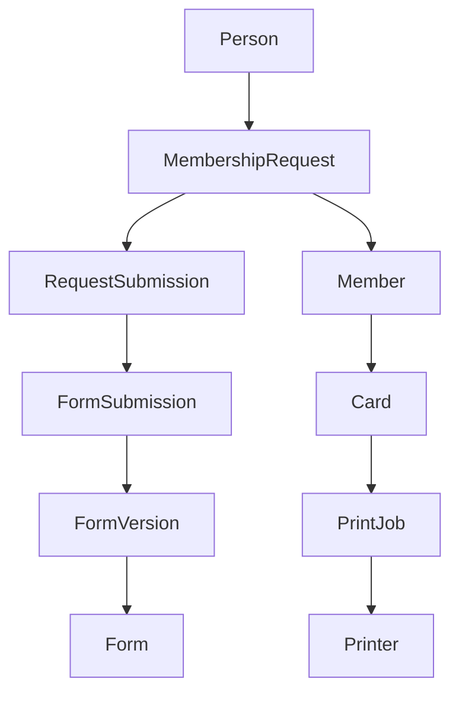

# معماری و تصمیمات پیاده‌سازی

## مرزها

یک فرآیند Next.js برای App Router/API و یک PostgreSQL مشترک. Worker چاپ فرآیند جدا با همان کد دامنه است، نه Microservice مستقل با دیتابیس جدا. Agent Windows فقط مرز سخت‌افزاری چاپ را پوشش می‌دهد.

| لایه    | مسیر                                        | مسئولیت                                           |
| ------- | ------------------------------------------- | ------------------------------------------------- |
| رابط    | `app/`, `components/`                       | فارسی RTL، فرم‌ساز، نمایش نسخه، عملیات اپراتور    |
| انتقال  | `app/api/[...path]/route.ts`                | مبدأ، نشست، اندازه درخواست، خطاهای عمومی و مسیرها |
| دامنه   | `lib/service.ts`, `workflow.ts`, `users.ts` | تراکنش، قواعد عضویت و مجوز عملیات                 |
| فرم     | `lib/forms/engine.ts`                       | نوع فیلد، طرح معتبر، visibility، پاسخ معتبر       |
| زیرساخت | `db.ts`, `storage.ts`, `audit.ts`           | Prisma، فایل و Audit                              |
| چاپ     | `services/printing/`                        | lease، idempotency و اتصال به درایور Windows      |

## مدل ارتباط

Person هویت حداقلی و مستقل دارد. پاسخ تخصصی فرم داخل Submission باقی می‌ماند. هر پاسخ به نسخه دقیق متصل است. جدول Value امکان استخراج کنترل‌شده فیلدها را فراهم می‌کند؛ داده JSON و Value در همان تراکنش نوشته می‌شوند. اطلاعات در Audit تکرار نمی‌شوند.

## تصمیم‌های هر مرحله

| مرحله          | تصمیم پیش از پیاده‌سازی                           | خروجی                        |
| -------------- | ------------------------------------------------- | ---------------------------- |
| ۱ معماری/DB    | Modular Monolith، FK/unique و snapshot            | Schema و SQL Migration       |
| ۲ ورود/RBAC    | نشست دیتابیسی، نقش‌های ثابت با Permissionهای جدا  | auth/users/permissions       |
| ۳ Form Builder | طرح JSON معتبر، بوم drag با dnd-kit               | FormBuilder                  |
| ۴ Renderer     | تفسیر عمومی فیلدها و RHF/Zod مشترک                | FormRenderer                 |
| ۵ Submission   | تنها نسخه منتشرشده فعلی؛ پاسخ تغییرناپذیر         | submit transaction           |
| ۶ Person       | نگاشت صریح و عدم بازنویسی خودکار فرد موجود        | هویت و duplicate detection   |
| ۷ Workflow     | ماتریس انتقال، expected status و Serializable     | تاریخچه + اصلاحیه            |
| ۸ Member       | ایجاد فقط در تأیید؛ unique روی person/request     | مدیریت عضو                   |
| ۹ Card         | snapshot قالب و QR تصادفی، حداقل اطلاعات عمومی    | قالب و صدور کارت             |
| ۱۰ Print       | جداسازی Spool از چاپ قطعی، lease و bridge durable | Worker + Windows Agent       |
| ۱۱ Reports     | خروجی کمینه، مجوز و خنثی‌سازی formula             | CSV                          |
| ۱۲ Audit       | تراکنشی برای تغییرات، append-only trigger         | AuditLog                     |
| ۱۳ Security    | کنترل سروری و fail closed                         | مبدأ، validation، فایل خصوصی |
| ۱۴ Tests       | تست رفتار و محدودیت‌ها، نه صرفاً ظاهر             | Unit/API/Browser             |
| ۱۵ Docker      | migrate قبل app، volume مستقل، worker profile     | Dockerfile/Compose           |
| ۱۶ Docs        | مسیر راه‌اندازی و محدودیت‌های قابل بررسی          | README و docs                |

## وضعیت‌ها

Request: NEW → UNDER_REVIEW → APPROVED/REJECTED؛ مسیر NEEDS_CORRECTION → UNDER_REVIEW و CANCELLED از وضعیت‌های باز مجاز است. INTERVIEW در مدل یک پاسخ مرتبط و flag تکمیل است، نه وضعیت جایگزین درخواست. MEMBER_CREATED، CARD_ISSUED و PRINTED در موجودیت‌های مربوط و Audit ثبت می‌شوند؛ وضعیت درخواست APPROVED باقی می‌ماند.

Member و Card تاریخ انقضای مستقل دارند. اعتبارسنجی فعال بودن وضعیت و تاریخ هر دو را بررسی می‌کند. صفحه اعضا عضویت ACTIVE با تاریخ گذشته را EXPIRED نشان می‌دهد، بدون نیاز به Job تغییر وضعیت شبانه. تعلیق عضو، اعتبار QR کارت‌هایش را فوراً از بین می‌برد.

## هم‌زمانی و بازیابی

`transaction()` از Serializable با حداکثر سه retry روی P2034 استفاده می‌کند. تغییر وضعیت علاوه بر آن expected status می‌خواهد. unique membership.personId/requestId مانع ایجاد دوباره عضو است. فرم‌ساز expectedVersion دارد تا تغییر هم‌زمان را با 409 برگرداند.

Worker با `FOR UPDATE SKIP LOCKED` یک کار را می‌گیرد. recovery همان شماره attempt را حفظ می‌کند. تلاش مجدد صریح کار FAILED شماره attempt جدید می‌سازد. Windows Agent کلید job-attempt را پیش از چاپ در SQLite ثبت می‌کند؛ پاسخ تکراری همان وضعیت قبلی را برمی‌گرداند.

## توسعه

برای خوانایی پروژه به فایل‌های دامنه تقسیم شده است؛ ورودی‌های API strict هستند. اگر عملیات زیادتر شد، route dispatcher را به routeهای مستقل تقسیم کنید؛ قواعد دامنه در lib/service باقی می‌مانند. افزودن provider ذخیره‌سازی با پیاده‌سازی StorageService انجام می‌شود؛ فایل‌ها داخل DB ذخیره نمی‌شوند.
